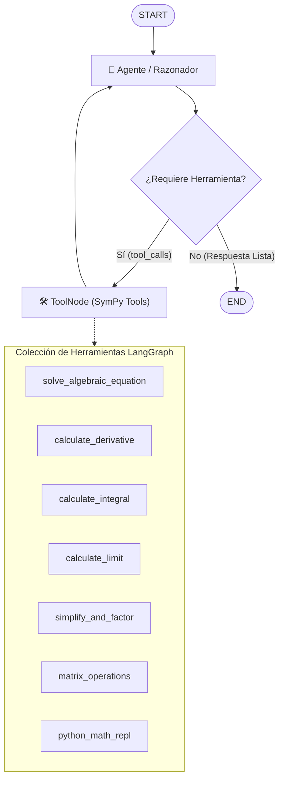

# 📐 LangGraph Math Tools & Agent System

Suite de herramientas matemáticas de alta precisión integradas en **LangGraph** y **LangChain** para la resolución exacta, analítica y simbólica de problemas de matemáticas avanzadas utilizando **SymPy**, **NumPy** y **Python REPL**.

---

## 🚀 Características Principales

1. **Herramientas Nativas `@tool` de LangChain/LangGraph**:
   - `solve_algebraic_equation`: Resolución exacta de ecuaciones algebraicas y polinomiales con raíces analíticas y decimales.
   - `calculate_derivative`: Cálculo simbólico de derivadas de orden $n$, con evaluación de pendientes y puntos críticos.
   - `calculate_integral`: Integrales indefinidas ($+ C$) e integrales definidas con límites numéricos o simbólicos ($\pi, \infty$).
   - `calculate_limit`: Límites analíticos bilaterales y unilaterales ($x \to 0, \infty, -\infty$).
   - `simplify_and_factor`: Simplificación, factorización y expansión de expresiones complejas.
   - `matrix_operations`: Determinantes, matrices inversas, rango, autovalores/autovectores y solución de sistemas $A \cdot x = b$.
   - `python_math_repl`: Entorno seguro de ejecución Python con SymPy y NumPy para cálculos libres.

2. **Arquitectura StateGraph con ToolNode**:
   - Ciclo reactivo `START` $\to$ `agent` $\rightleftarrows$ `tools` $\to$ `END`.
   - Soporte para memoria conversacional mediante `MemorySaver`.
   - Capacidad híbrida: compatible con modelos LLM (OpenAI, Gemini) y con enrutador determinista offline.

---

## 🏗️ Diagrama de Arquitectura (LangGraph)



---

## 📦 Instalación y Requisitos

```bash
pip install -r requirements.txt
```

---

## 💻 Ejecución

### 1. Ejecutar la consola interactiva:
```bash
python main.py
```

### 2. Ejecutar los tests unitarios automatizados:
```bash
python test_tools.py
```
